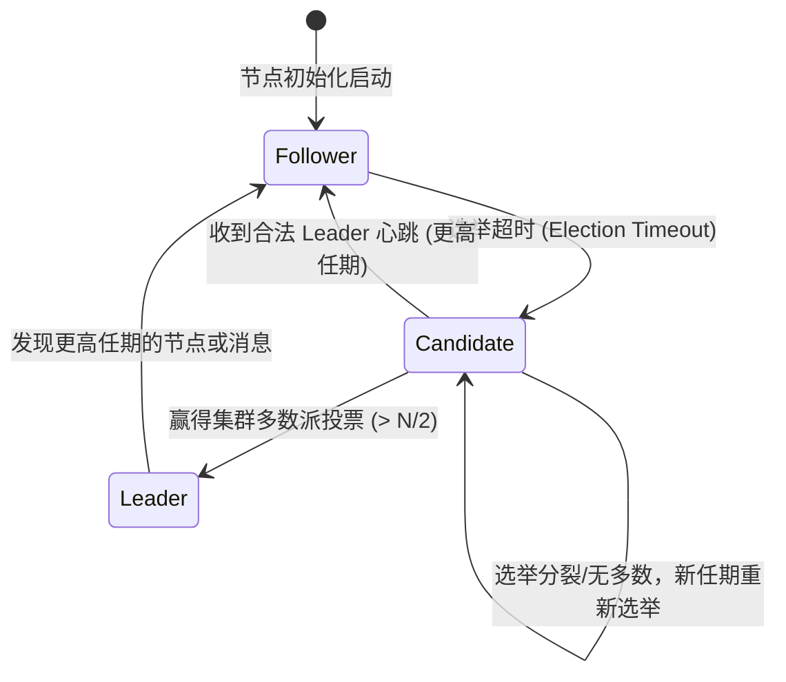

# Mini-Raft 系统设计与工程实现

Mini-Raft 是一个用于学习和理解分布式共识机制的轻量级 Raft 实现。它剥离了复杂的生产级外部依赖，以纯净的 Go 标准库（goroutine + channel + mutex）完整呈现 Raft 论文中的核心不变式。

:::note
共识算法的核心目标是：在哪怕部分节点崩溃或发生网络分区的情况下，让一组分布式机器对状态机的一系列操作达成不可动摇的一致。
:::

## 核心架构设计

在 Raft 协议中，任意时刻集群节点必须且仅能处于以下三种状态之一：

### 1. 状态机模型 (`internal/raft/state.go`)
- **Follower**：完全被动响应 Leader 的心跳与 Candidate 的拉票；若在随机超时时间内未收到心跳，则转为 Candidate。
- **Candidate**：发起拉票请求（RequestVote），若获得超过半数选票则晋升为 Leader。
- **Leader**：负责处理所有客户端请求，并向 Follower 发送日志追加请求（AppendEntries）。

### 2. 选举安全保证
- 每个任期（Term）内，每个节点最多只能投出一票（先到先得原则）。
- 只有具备“最新日志”（比较 `LastLogTerm` 与 `LastLogIndex`）的候选人才有资格获得选票，从而杜绝未提交日志被覆盖的问题。

---

## 工程文件索引

- `cmd/main.go`：多节点集群本地仿真启动入口。
- `internal/raft/state.go`：节点核心状态结构体与角色定义。
- `internal/raft/election.go`：领导人选举核心逻辑与投票 RPC 处理。
- `internal/raft/log.go`：日志条目（LogEntry）存储与追加逻辑。

请在左侧文件目录树中点击对应源码文件进行阅读与对比。
